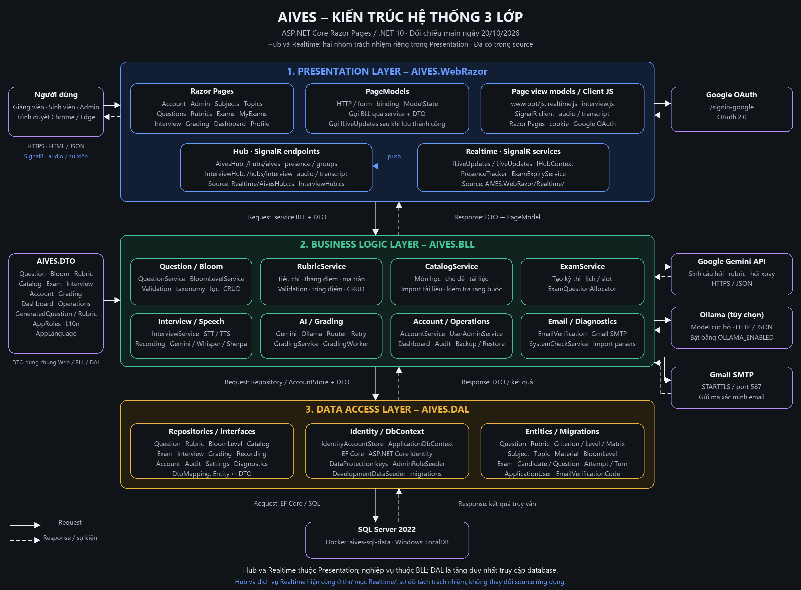

# AIVES — Review kiến trúc 3 lớp và sơ đồ draw.io

Đối chiếu trực tiếp `E:\PRN213\AIVES_System` ngày **24/10/2026**, commit nền `180181a` (`Read viva questions with VieNeu-TTS and remove Whisper`). Sơ đồ dựa trên source tại máy, không suy ra từ các phiên bản cũ hay từ tên thư mục còn sót lại.

- [draw.io chỉnh sửa được](AIVES-3-Layer-Architecture.drawio)
- [SVG phóng to](AIVES-3-Layer-Architecture.svg)
- [PNG 2500 × 1860](AIVES-3-Layer-Architecture.png)

## Kết quả review cấu trúc

`AIVES_System.slnx` có **5 project đang hoạt động**. Ba project xử lý tạo thành ba lớp logic; DTO là hợp đồng dữ liệu dùng chung, Tests phục vụ kiểm thử. Đây không phải sơ đồ ba máy chủ triển khai.

| Project | Trách nhiệm đã xác nhận | Tham chiếu project trực tiếp |
|---|---|---|
| `AIVES.WebRazor` | Presentation: Razor Pages, PageModels, page view models, JS, HTTP/auth, Hub và Realtime | BLL, DTO |
| `AIVES.BLL` | Nghiệp vụ Question/Bloom, Rubric, Catalog, Exam, Interview, AI/Grading, Account, Dashboard, Operations, Email, Speech/TTS và Recording | DAL, DTO |
| `AIVES.DAL` | Repositories, DTO/entity mapping, IdentityAccountStore, DbContext, EF Core SQL Server, entities, migrations và khởi tạo dữ liệu | DTO |
| `AIVES.DTO` | DTO, dữ liệu yêu cầu/kết quả, roles, enum và localization | Không tham chiếu các project ứng dụng |
| `AIVES.Tests` | Unit, HTTP/SignalR, ranh giới layer và integration | WebRazor, BLL, DAL, DTO |

`AIVES.WebMVC`, `AIVES.Business` và `AIVES.DataAccess` không có project đang được solution sử dụng. Các thư mục này còn artifact cũ như bin/obj, `.csproj.user` và database cũ; không đưa vào sơ đồ kiến trúc đang chạy và không xóa chúng trong lần cập nhật này.

Nguồn đối chiếu: `AIVES_System.slnx`, bốn file `.csproj` ứng dụng, `AIVES.WebRazor/Program.cs`, `AIVES.WebRazor/RazorPresentation.cs`, `AIVES.BLL/DependencyInjection.cs`, `AIVES.DAL/DependencyInjection.cs`.

## Hub và Realtime cùng thuộc Presentation

Hai khối được tách theo trách nhiệm trên hình; **cùng nằm trong `AIVES.WebRazor`**. Source hiện tại cùng đặt các file trong thư mục/namespace `AIVES.WebRazor.Realtime`. Không cần tạo thêm project hoặc di chuyển lớp để đáp ứng vị trí tầng này.

| Khối | Thành phần thật | Vai trò |
|---|---|---|
| Hub | `Realtime/AivesHub.cs` | Endpoint `/hubs/aives`: kết nối, presence, nhóm staff/admin/candidate/question |
| Hub | `Realtime/InterviewHub.cs` | Endpoint `/hubs/interview`: `WatchExam`, kiểm tra quyền qua `IExamService`, đăng ký nhóm giám sát kỳ thi |
| Realtime | `Realtime/LiveUpdates.cs` | `ILiveUpdates`/`LiveUpdates` dùng `IHubContext<AivesHub, IAivesClient>` để gửi thay đổi entity, kỳ thi và tài khoản tới đúng nhóm/người dùng |
| Realtime | `Realtime/PresenceTracker.cs` | Theo dõi presence và người chỉnh sửa trong bộ nhớ tiến trình |
| Realtime | `Realtime/ExamExpiryService.cs` | Background service gọi `IExamService` và phát sự kiện kỳ thi hết thời gian |

`RazorPresentation.cs` đăng ký `AddSignalR`, JSON protocol, presence, live updates và expiry service. `Program.cs` ánh xạ hai Hub cùng Razor Pages và health endpoint.

**Sửa mô tả cũ:** `InterviewHub` hiện không nhận microphone stream, không chạy Speech/Recording và không điều phối câu trả lời. `Pages/Interviews/Interview.cshtml.cs` (`InterviewApiModel`) nhận HTTP, gọi service Interview/Recording/TTS rồi phát thông báo giám sát qua `IHubContext<InterviewHub, IInterviewClient>`. Phía client có Web Speech STT; phần TTS của BLL có VieNeu, Gemini và các phương án local. Không đưa Whisper vào sơ đồ hiện tại vì source đã loại bỏ nó.

BLL không tham chiếu lớp Hub của Presentation. Việc dùng `IHubContext` không phải tự tạo hoặc gọi trực tiếp instance Hub. SignalR push là sự kiện chủ động, không nhất thiết tương ứng với một HTTP request.

## Những chỉnh sửa so với hình tham chiếu

| Điểm cần sửa/bổ sung | Thể hiện trong sơ đồ mới |
|---|---|
| Razor Pages thiếu PageModel | Khối `Razor Pages / PageModels`, có binding và lời gọi service BLL |
| Hub/Realtime chưa ghi rõ thành phần thật | Hai khối riêng, tên hai Hub, endpoint và các realtime services |
| BLL còn giản lược | Bổ sung GradingWorker, TTS, Recording, Dashboard và Operations vào các nhóm nghiệp vụ |
| Third-party thiếu TTS hiện tại | Gemini, Ollama tùy chọn, Gmail SMTP, VieNeu-TTS tùy chọn; Google OAuth kết nối Presentation |
| DTO có thể bị hiểu là gửi request tới từng tầng | Mũi tên tím từ mỗi tầng tới DTO biểu thị dùng chung hợp đồng dữ liệu, không phải request/response |
| Chỉ có SQL Server, bỏ sót file bản ghi | Thêm Recording storage và đường File I/O từ BLL qua `IRecordingStore` |
| DAL chưa nêu migration hiện tại | Có 13 migration, mới nhất `20261020211119_AddExamQuestionPool` |
| Giao diện sơ đồ khó đọc/chỉnh | Nền sáng, phân lớp theo màu, một trang; các module là shape có nhãn và connector gắn source/target |

## Luồng và ranh giới dữ liệu

1. Trình duyệt gọi Razor Page/PageModel qua HTTP; các kết nối SignalR nhận sự kiện realtime.
2. PageModel kiểm tra binding/ModelState, gọi BLL qua service và DTO.
3. BLL kiểm tra nghiệp vụ, gọi repository/AccountStore của DAL. DAL dùng EF Core/Identity để đọc/ghi SQL Server và trả DTO.
4. PageModel hiển thị/trả kết quả; sau khi lưu thành công có thể phát cập nhật bằng `ILiveUpdates` hoặc `IHubContext`.
5. AI, SMTP và TTS được BLL gọi qua adapter/service. Google OAuth là cấu hình giao thức xác thực của Presentation.
6. **SQL/database persistence thuộc DAL.** File bản ghi là luồng lưu trữ riêng: `IRecordingStore`/`FileRecordingStore` hiện đặt ở BLL và được cấu hình trong `AIVES.BLL/DependencyInjection.cs`; dữ liệu metadata của bản ghi được lưu qua repository DAL. Không mô tả DAL là nơi duy nhất thực hiện mọi loại I/O.

Đây là mô hình hiện trạng, không tự tái cấu trúc source ứng dụng. Với kiểm tra source và kiểm thử ranh giới hiện có, không cần thay đổi project references hoặc chuyển Hub xuống BLL/DAL.

## Kiểm tra đã thực hiện

- Đọc solution, project references, DI, Program, Hub/Realtime, HTTP interview PageModel và các nhóm service/repository liên quan.
- `python scripts/render_architecture.py`: xuất PNG/SVG/draw.io; kiểm tra XML, ID duy nhất, parent tồn tại, mỗi edge có source/target hợp lệ và các module nằm trong đúng container.
- Kiểm tra trực quan ảnh PNG để sửa phần nhãn và mũi tên bị chồng.
- `dotnet test AIVES.Tests/AIVES.Tests.csproj --no-restore -c Release --filter FullyQualifiedName~LayerTests.PresentationAndBusinessDoNotReferenceEfOrPersistenceEntities --verbosity minimal`: **1 passed, 0 failed, 0 skipped**. Lệnh có build các project liên quan; hiện có 4 cảnh báo CA1416 ở `SystemTextToSpeech` vì `System.Speech` chỉ hỗ trợ Windows.
- Không chạy toàn bộ functional/live API/SQL integration suite; kết quả trên chỉ xác nhận kiểm thử ranh giới assembly, không xác nhận hoạt động production của mọi tích hợp.

## Mở và xuất lại

Mở `docs/AIVES-3-Layer-Architecture.drawio` bằng draw.io Desktop hoặc diagrams.net. Các khối, nhãn và đường nối là đối tượng gốc, không phải ảnh nền; có thể di chuyển module cùng container và chỉnh nội dung. Đường nối dùng source/target ID và các waypoint để giữ bố cục. PNG là bản xem nhanh và SVG là bản vector.

Chạy `python scripts/render_architecture.py` để xuất lại cả ba định dạng; cần Pillow và font Segoe UI trên Windows. Script hiện chứa nội dung review ngày 24/10/2026; cập nhật nhãn theo source khi kiến trúc thay đổi. Việc chạy lại sẽ ghi đè ba file xuất từ script, nên lưu bản riêng nếu chỉnh tiếp trong draw.io.
